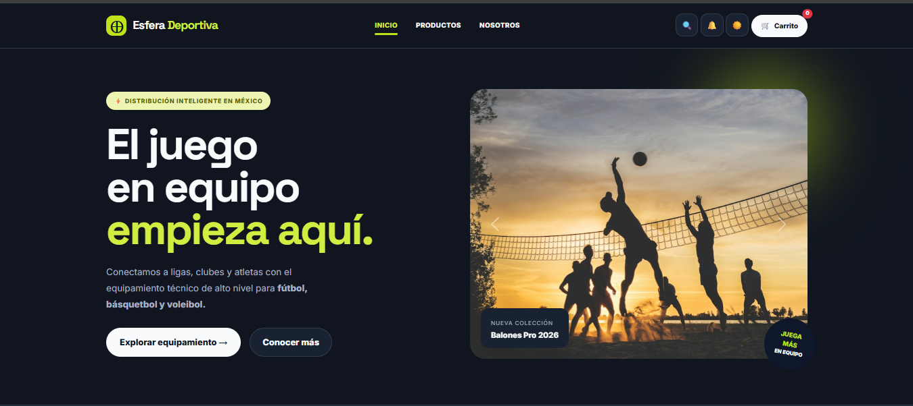

# Esfera Deportiva

Landing page de una tienda en línea de equipamiento para deportes de conjunto (fútbol, básquetbol y fútbol americano) en México. Proyecto desarrollado durante el hackathon de Generation México.

🔗 **Demo:** https://jesusperalta0.github.io/esfera-deportiva/




## Características

- Diseño responsive con menú adaptable a celular y escritorio.
- Portada con carrusel de imágenes y llamadas a la acción.
- Catálogo de productos con filtros por categoría.
- Carrito de compras: agregar, quitar y modificar productos, con pago simulado. El carrito se conserva al recargar la página.
- Modo oscuro que recuerda la preferencia del usuario.
- Sección «¿Quiénes somos?» con misión y visión.

## Mi participación

Trabajé como desarrollador front-end en un equipo de 4 personas durante un hackathon de 8 horas:

- Desarrollé el carrito de compras con HTML, CSS, JavaScript y Bootstrap.
- Implementé el modo oscuro de la página.
- Integré mi código con Git y GitHub junto con el resto del equipo.

## Tecnologías

- HTML5
- CSS3 (variables, Grid, Flexbox)
- JavaScript (módulos ES)
- Bootstrap 5.3
- Git y GitHub
- Vite (entorno de desarrollo)

## Cómo ejecutarlo

1. Clona el repositorio:
   ```bash
   git clone https://github.com/JesusPeralta0/esfera-deportiva.git
   cd esfera-deportiva
   ```
2. Instala las dependencias:
   ```bash
   npm install
   ```
3. Inicia el servidor de desarrollo:
   ```bash
   npx vite
   ```
4. Abre en el navegador la dirección que aparece en la terminal (normalmente `http://localhost:5173`).

## Estructura

```
esfera-deportiva/
├── index.html
├── src/
│   ├── styles.css
│   └── index.js
├── img/
│   └── captura.png
├── package.json
└── README.md
```

Proyecto desarrollado en equipo de 4 personas durante el hackathon de Generation México. Este repositorio es una copia personal; el repositorio original del equipo está aquí: cbas-o7/HACKATON-1-GEN.

## Autor

**Jesus Antonio Alvarez Peralta**
[GitHub](https://github.com/JesusPeralta0) · [LinkedIn](https://www.linkedin.com/in/jesus-alvarez-peralta) · jesus.alvarezperalta.92@gmail.com
